# SyngOS Troubadour — an open mod kit for Syng Cell speakers

Keep Syng Cell Alpha speakers useful without Syng's cloud: a flashable firmware mod, a
self-hosted web UI that runs **on the speakers**, offline room setup/grouping/calibration with
**no 5-cell limit**, a faithful WebGL port of the app's sound-field control, LED control, and the
reverse-engineering notes that explain how all of it works.

> Not affiliated with Syng. You are reflashing a speaker's eMMC: read the recovery notes first.
> Everything here was recovered from the stock firmware image and from the speakers themselves.

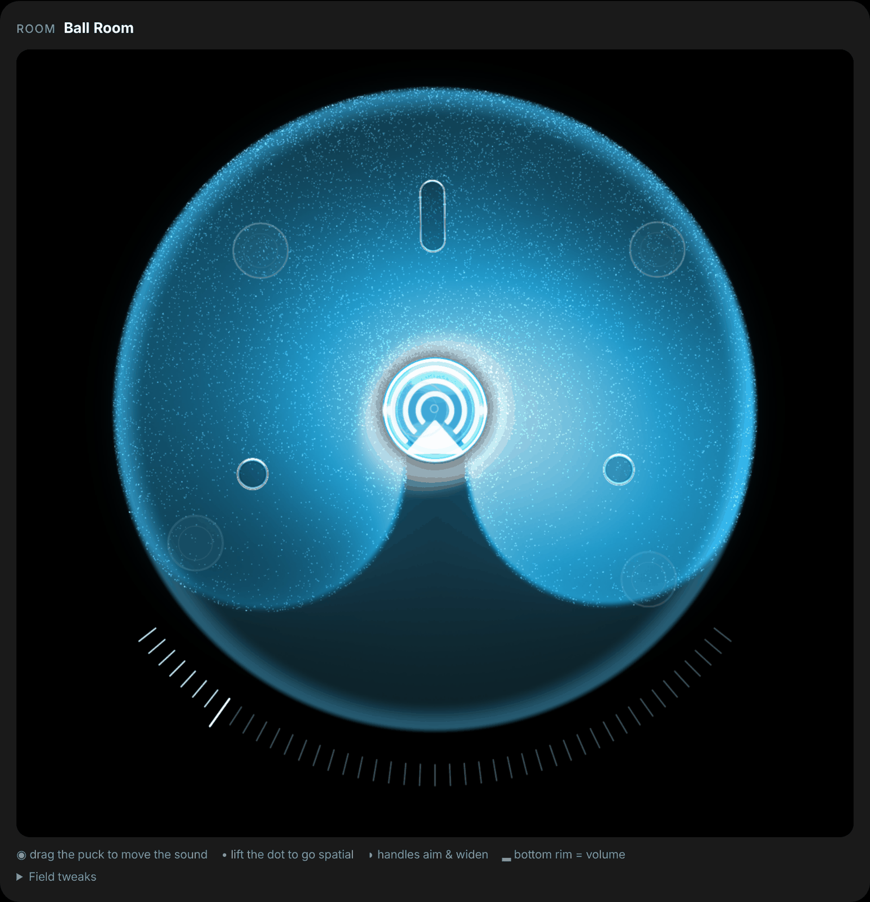

*The app's sound-field control, rebuilt in WebGL from the app's own Metal shaders and served by the
speaker itself: drag the puck to move the sound, lift the dot for the spatial pair, the handles aim
and widen it, the bottom rim is volume. The particles react to the music through the cell's own
visualisation feed — no microphone.*

## What you get

| | |
|---|---|
| **Firmware mod** (`overlay/`, `tools/fw/`) | SSH (root, password + keys), USB-Ethernet drivers (wired setup link), OTA masked so Syng can't revert you, the agent + cloud-block services baked in. `build-troubadour.sh` stamps it onto any stock image (2.2.1 and 2.2.2 verified). |
| **syng-agent** (`agent/`) | a single-file Python 3.7 service on every cell, port 8080: live dashboard (sources, volume, tone, spatial toggles, room EQ, temperatures, faults, accelerometer, eMMC health, CPU/RAM), the **sound-field control** (puck / spatial / focus dots / volume rim, music-reactive, driven through the cell's own spatialiser), LED modes (music-reactive from the real audio feed, no mic), fleet view, theme. |
| **`/setup`** — the Syng app replacement | Wi-Fi, discover cells on the LAN, create/join/leave rooms, **more than 5 cells per room**, room map with the app's gestures (drag / pinch / twist the group, snap speakers, live preview on the speakers, undo), **Soundcheck** run on-device with the results kept locally, housekeeping, cloud block toggles, restore. Works over a plain USB-C cable (the cell is a USB-Ethernet device at `http://10.86.0.1:8080/setup`). |
| **Phone apps** (`apps/`) | iOS (SwiftUI) and Android (Compose) companions: Bonjour/NSD discovery (no IPs), a native Now Playing with a haptic volume slider, Sound mode, Scenes, speaker naming, Siri Shortcuts / a Quick Settings tile, home-screen widgets, the **sound field drawn natively in Metal** (the web renderer ported, particles in a compute kernel) — and the cells' own setup page embedded, so firmware can be installed from the phone. [apps/README.md](apps/README.md). |
| **Cloud block** (`syng-cloud-block`) | DNS + firewall block of `syng.space` per cell, persistent across reboots, toggled from the dashboard. Off = Syng's cloud takes over again. |
| **Docs** (`docs/`) | [HACKING](docs/HACKING.md) (workflow, gotchas) · [FIRMWARE-MODS](docs/FIRMWARE-MODS.md) (hardware, partitions, SSH/LED/USB mods, flashing, recovery) · [CELL-INTERNALS](docs/CELL-INTERNALS.md) (every daemon, the cloud state document, the LAN control API, grouping/SyFi, calibration, USB gadget) · [SETUP](docs/SETUP.md) (the offline setup flow + the agent's HTTP API) · [SOUND-FIELD](docs/SOUND-FIELD.md) (the app's field reproduced from its Metal shaders and asset catalog) · [FIRMWARE-2.2.2](docs/FIRMWARE-2.2.2.md) (what Syng changed, rebasing) · [DBUS-API](docs/DBUS-API.md) (detailed `com.syng.*` calls and JSON schemas) · [LED](docs/LED.md) (LED daemons, reactive modes) · [FIRMWARE-UPDATES](docs/FIRMWARE-UPDATES.md) (in-place A/B updates, keeping up with Syng releases) · [WIRED](docs/WIRED.md) (cell-to-cell over Ethernet: how SyFi's clock works, the `ntp`+PTP path, the wired link mode) · [ROADMAP](docs/ROADMAP.md) |

## What it looks like

Everything below is served by a speaker on your network — no app, no account, no cloud. (These are
captured from the pages themselves against canned data; `tools/shots/` has the mock server and the
capture script if you want to regenerate them.)

### The dashboard — `http://<cell-ip>:8080/`

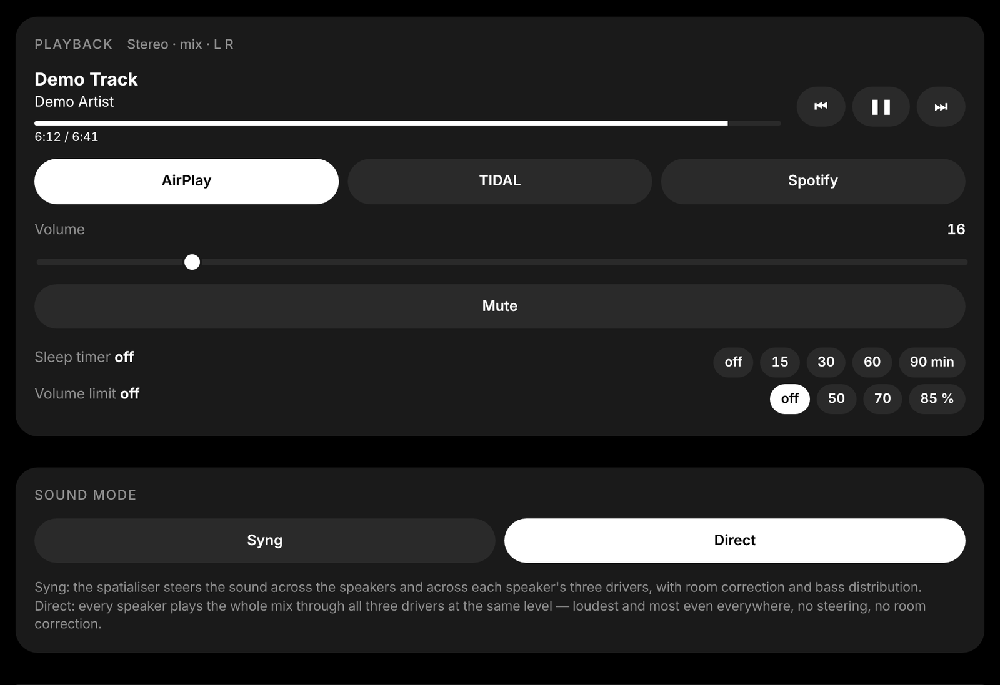

Sources, transport, room volume with a limit, sleep timer — and **Sound mode**: *Syng* is the stock
spatialiser (steering, room correction, bass distribution), *Direct* makes every speaker play the
whole mix through all three drivers at the same level, which is louder and even everywhere.

| | |
|---|---|
| 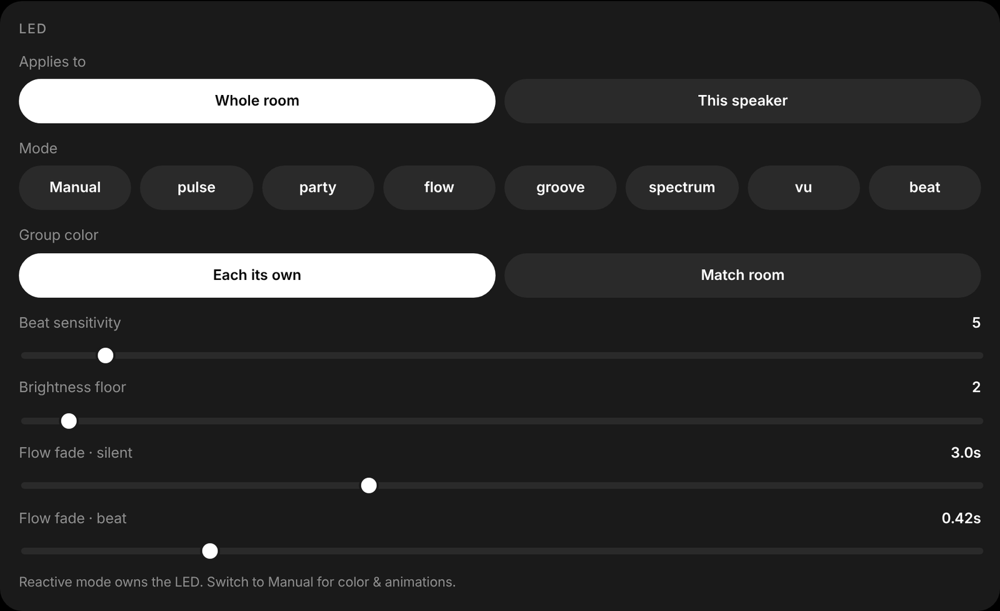 | 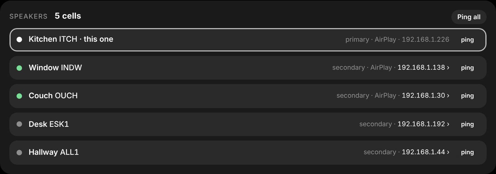 |
| **LED** — eight music-reactive modes driven from the cell's real audio feed (no mic), per speaker or room-wide, with manual colour and animations. | **Speakers** — every cell in the room: role, link and time-sync health, Wi-Fi signal, agent build, with ping and a link to each one's own page. |
| 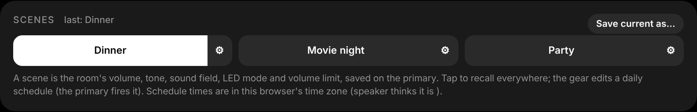 | 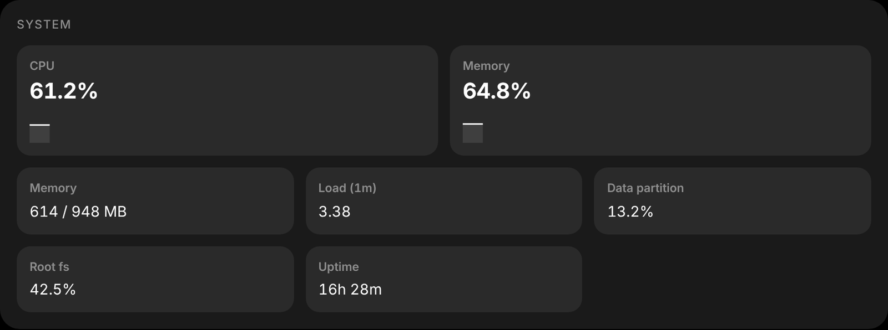 |
| **Scenes** — volume, tone, sound field, LED mode and limits saved on the primary and recalled everywhere, optionally on a daily schedule. | **System** — temperatures, faults, accelerometer, eMMC wear, CPU/RAM, uptime; the housekeeping panel finds core dumps and journal bloat. |

The pages follow the Syng app's look, and there's a light variant:

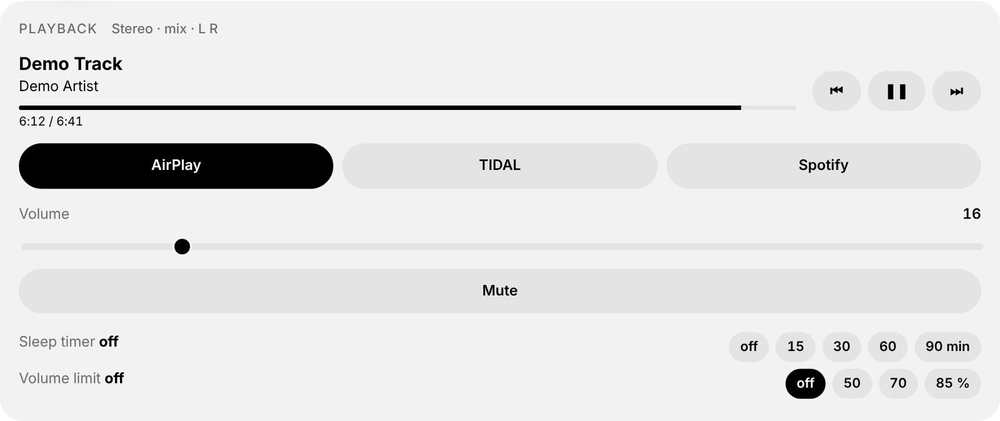

### Setup — `http://<cell-ip>:8080/setup`

The Syng app replacement. Over Wi-Fi, or over a plain USB-C cable at `http://10.86.0.1:8080/setup`
(the cell is a USB-Ethernet device), which is how you set up a speaker that has never been on your
network.

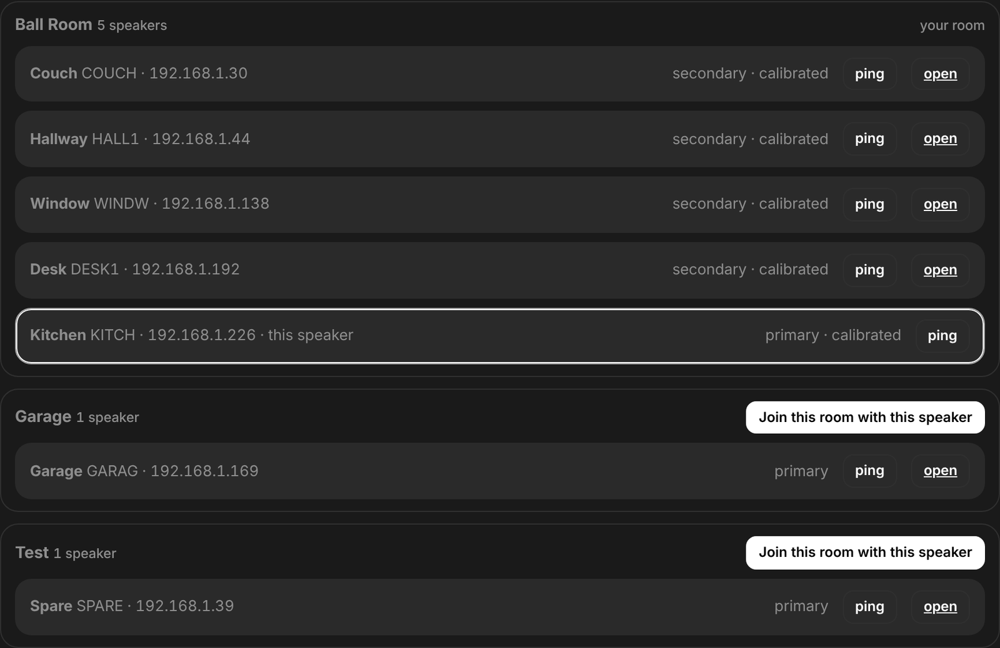

Every Cell on the LAN — Troubadour or stock — with its room, role and firmware; create a room, join,
leave, remove, make primary. **More than five cells per room**: that limit was the app's and the
cloud's, not the speakers'.

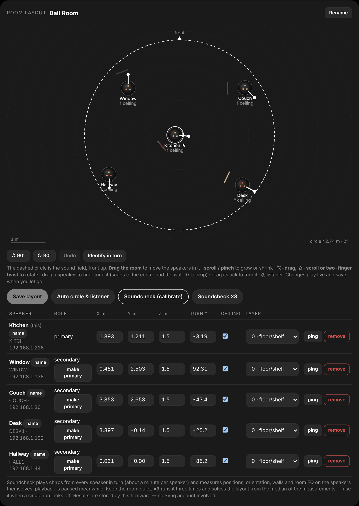

The room map with the app's own gestures (drag the group, pinch to resize, twist to rotate, drag a
speaker to fine-tune, snap to the centre or a wall), live preview on the speakers while you drag,
undo, and per-speaker names. **Soundcheck** runs the firmware's own calibration on the speakers —
round-robin chirps, time-of-flight and angle-of-arrival, layout estimation, room EQ, wall detection
— and keeps the results locally; **×3** runs it three times and solves from the median when one pass
looks off.

| | |
|---|---|
| 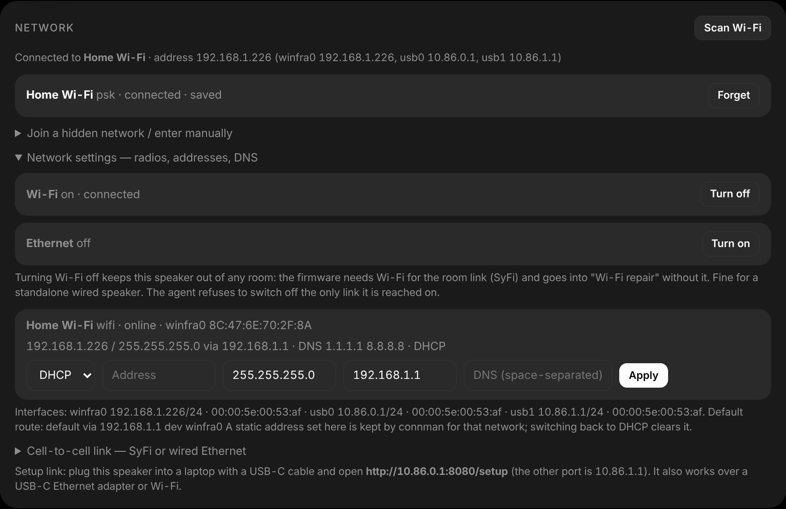 | 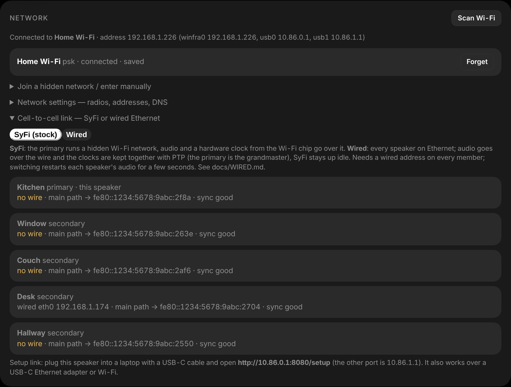 |
| **Network** — Wi-Fi join/forget/scan, radio power, DHCP or static addressing and DNS per service. | **Cell-to-cell link** — keep Syng's SyFi radio link, or move audio and the clock onto wired Ethernet with PTP ([docs/WIRED.md](docs/WIRED.md)). |

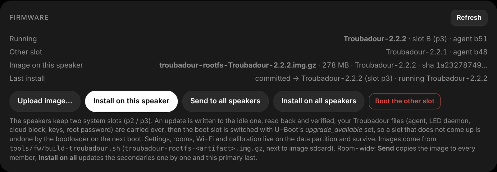

In-place firmware updates over the stock A/B slots: upload a Troubadour image once, install it on
this speaker or on the whole room, with read-back verification, automatic rollback if the stack
doesn't come up, and your Troubadour files carried across ([docs/FIRMWARE-UPDATES.md](docs/FIRMWARE-UPDATES.md)).

### On a phone

iOS and Android companions find the speakers by Bonjour/NSD (no addresses to type), add a native
Now Playing with a haptic volume slider, Siri Shortcuts, a Quick Settings tile and home-screen
widgets for the sound field and the LEDs — and embed the pages above for everything else.
See [apps/README.md](apps/README.md).

## Quick start

**You need:** a stock firmware package (`image.sdcard.lzma`, `imx-boot`, `manifest.json` — from
*Syng Firmware Updater.app/Contents/Resources/Firmware/*; not redistributed here), `uuu`
(`brew install uuu`), `e2fsprogs` + `xz` (`brew install e2fsprogs xz`), and a USB-C cable.

```sh
git clone … syng-troubadour && cd syng-troubadour
export ROOT_PASSWORD='pick-one'                      # root password baked into the image
export SSH_PUBKEY="$(cat ~/.ssh/id_ed25519.pub)"     # your key, for passwordless root
tools/fw/build-troubadour.sh ~/stock-firmware/image.sdcard.lzma build
cd build && ./flash.sh        # put the Cell in USB serial-download mode when asked
```

Then, with the cell on your network: `http://<cell-ip>:8080/` is the dashboard,
`http://<cell-ip>:8080/setup` sets it up (or plug it straight into a laptop over USB-C and open
`http://10.86.0.1:8080/setup`). The first thing to do there is **Block cloud** — after that the
room document on the speakers is authoritative and Syng's servers can't overwrite it.

Already running Troubadour? A new firmware goes in from the setup page (FIRMWARE → upload the `troubadour-rootfs-*.img.gz` the build wrote, install on all speakers — see docs/FIRMWARE-UPDATES.md). Just the agent, over SSH:
`agent/deploy.sh agent/syng-agent.py 192.168.1.10 192.168.1.11 …`

## Repository layout

```
agent/syng-agent.py        the agent (b51) — deploy as /usr/bin/syng-agent
agent/deploy.sh            push a build to running cells over SSH
agent/build/               how the agent is assembled: localcloud.py (room authority, discovery,
                           join/leave, layout, calibration, USB link, Wi-Fi), housekeeping.py,
                           setup.html (the /setup page), build_b26…b51.py + field/map patches, parts/, history/
field/                     SyngField WebGL renderer (field.js), demo.html (synthetic music + tweak
                           sliders), textures.js (gloss maps / lens table / glyph recovered from the app)
overlay/                   every file the mod adds to the stock rootfs (what build-troubadour.sh stamps in):
                           syng-agent, syng-led (LED CLI), syng-led-reactive (music-reactive LED daemon),
                           syng-cloud-block, syng-dbus-dump, syng-ptp4l + syng-pmc (our linuxptp build),
                           units, connman/usb-ethernet/wired configs
tools/fw/                  build-troubadour.sh (stock image → Troubadour image), sha512crypt.py
tools/ptp/                 build.sh + patch for syng-ptp4l / syng-pmc (linuxptp, static aarch64 via zig)
tools/shots/               mock.py + capture.js + demo-data: serves the agent's pages against
                           canned data and takes the screenshots in docs/img
tools/carx.py              Assets.car extractor (BOM + CSI + chunked lzfse)
tools/split_metallib.py    metallib → LLVM bitcode (then llvm-dis) for the shaders
firmware/                  flash.sh + syng-cell-flash.uuu (uuu flow) + stock manifests; no images
apps/ios, apps/android     companion apps (XcodeGen spec / Gradle project), see apps/README.md
docs/                      see above; docs/img/ holds the screenshots
attic/                     earlier field builds, kept for the record
```

## How it works, in one paragraph each

**Grouping without the cloud.** Each cell keeps Syng's *cloud state document*
(`cell_state` / `room_state` / `room_neighbours`) in `cloudsyncd`, and every on-cell consumer —
celldirector (rooms, roles, the SyFi link), the spatialiser, the calibrator — reacts to
`cloudsyncd.PatchState`, the same entry point the cloud uses. The agent on the room's primary
is the writer: it builds each member's view and pushes it over HTTP to that member's agent,
which patches it in. The 5-cell cap lived in the app and the cloud only.

**Calibration.** Soundcheck is entirely on-device (`DasCalibrator.Runner.Run()`: round-robin
chirps, ToF/AoA, layout estimation, room EQ, wall detection). Only the final positions went to the
cloud; a 40-line patch to `pycalibrator/cloudapi.py` posts them to the local agent, which
updates the room document, computes the reference circle (the cloud's rule: smallest enclosing
circle of the cells, radius ÷ 0.85) and fans it out. Recalibrations are aligned to the previous
layout so the map keeps its orientation.

**The sound field.** `cellbroker` (JSON-RPC over `wss://cell:8765`, no auth) is what the app
drives on the LAN; `source_set_stem_positions` with a `panner_v2` handle (puck in room-circle
units, rotation, width, radius 0 = classic / 0.7 = spatial) is the whole sound-field API. The
renderer reproduces the app's look from its own Metal shaders (particle kernel, capped-torus SDF,
pulse-texture displacement) and Assets.car (Orb gloss maps, lens table, palettes).

## Safety and recovery

* Flashing writes the whole eMMC image; re-flashing the stock package with the same `uuu` flow
  restores a stock speaker. `imx-boot` and fuses are never touched.
* The mod turns a speaker into a root-login box on your LAN. Change the password, use keys,
  keep it off untrusted networks.
* Everything the agent writes to a cell's state is reversible: the pre-agent document is saved
  on first touch (`/data/syng-agent/state-before-agent.json`, *Advanced → Restore*), and
  unblocking the cloud lets Syng's servers re-impose whatever they last knew.
* Soundcheck plays chirps at a moderate fixed level; the agent never changes your volume.

## Status

Verified on seven Cell Alphas — six on Troubadour 2.2.2 (one flashed with `build-troubadour.sh`, five updated in place from the setup page) and one on 2.2.1: six in one room with SourceCast + SyFi +
time sync, leave/join through the UI, three on-device Soundchecks, DHCP address changes picked up
automatically. The never-set-up path is verified on a factory-fresh 2.2.2 flash (b39, seven cells managed). Open items are in [docs/ROADMAP.md](docs/ROADMAP.md) (wired
rooms beyond the SyFi station limit, calibration averaging).

## Legal

Code in this repository is MIT (see `LICENSE`), with one exception: `overlay/usr/bin/syng-ptp4l`
and `syng-pmc` are static builds of [linuxptp](https://github.com/richardcochran/linuxptp), which is
GPLv2 — the exact upstream commit, the one-line patch and the build script that reproduces them are
in `tools/ptp/`.

The kit interoperates with proprietary firmware and an app that are not included: you bring your own stock firmware package. `field/textures.js` and the
palettes in `docs/SOUND-FIELD.md` were recovered from the Syng Space app's asset catalog for
interoperability (to reproduce the control the speakers were sold with); if you'd rather not
redistribute them, delete `field/textures.js` and rebuild the agent — the field renders with flat
fallbacks. Syng and Cell are trademarks of their owner.
